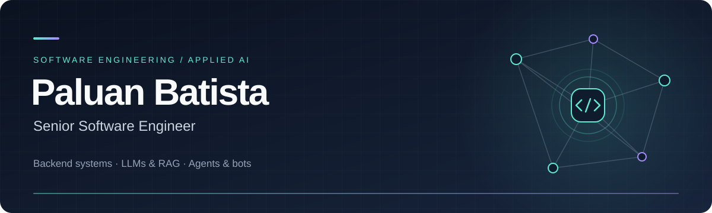

## Hi, I'm Paluan 👋

I'm a **Senior Software Engineer** based in **Ribeirão Preto, Brazil**, with experience building financial products and digital platforms at **Creditas, PagBank, PicPay and iFood**.

My work spans **backend engineering, distributed systems, cloud infrastructure and applied AI**. I work with Go, Kotlin, Java and Clojure, with strong experience in **AWS and DigitalOcean**. More recently, I worked at **SintetizaAI with LLMs and RAG**. I also build **AI agents, bots and automations**.

### What I work with

| Area | Experience & tools |
| :--- | :--- |
| **Backend & architecture** | Go · Kotlin · Java · Clojure · TypeScript · Spring Boot · Microservices · BFF · Server Driven UI |
| **AI & automation** | LLMs · RAG · AI agents · Bots · n8n |
| **Development workflow** | Codex · Claude Code · Linear · Git |
| **Cloud & delivery** | **AWS · DigitalOcean** · GCP · Docker · Kubernetes · Helm · Terraform · CI/CD |
| **Data & messaging** | PostgreSQL · MySQL · MongoDB · Redis · Datomic · Kafka · RabbitMQ |
| **Observability** | OpenTelemetry · Grafana · Prometheus · Datadog · New Relic · Dynatrace |

### Cloud infrastructure

Strong experience with **AWS and DigitalOcean**, alongside containerized applications, infrastructure as code and delivery pipelines.

On AWS, my experience includes **EC2, S3, SNS, SQS, Glue, Athena and EKS**, supporting backend services, integrations and batch processing.

### AI, agents & automation

- **SintetizaAI:** recent experience with large language models (**LLMs**) and retrieval-augmented generation (**RAG**).
- **Agents & bots:** building AI agents, bots and automated workflows, including **n8n**.
- **Development workflow:** working with **Codex, Claude Code and Linear**.
- **Continuing education:** pursuing postgraduate studies in **Applied Artificial Intelligence at Coders**.

### Career highlights

| Company | Selected work |
| :--- | :--- |
| **Creditas** | Backend development, technical refinement and Server Driven UI with Go, Kotlin, Java and AWS. |
| **PagBank** | High-volume file batch processing with Kotlin and AWS, and financial integrations. |
| **PicPay** | Server Driven UI for shopping and gift cards, plus service monitoring with metrics and telemetry. |
| **iFood** | Catalog BFF and microservices, with monitoring for services handling high request volumes. |
| **Monitora** | Web development and integrations with Salesforce APIs. |
| **iDtrust** | Financial software development with Clojure, Java and Spring Boot. |

### Explore my work

Public examples of backend development, resilience and observability:

| Project | What you'll find |
| :--- | :--- |
| [**Circuit Breaker in Go**](https://github.com/paluan-batista/circuit-breaker-go-example) | A practical circuit breaker example using Go and gobreaker. |
| [**DevBook API**](https://github.com/paluan-batista/api-devbook) | A social network backend API written in Go. |
| [**Prometheus & Grafana**](https://github.com/paluan-batista/prometheus-grafana) | An endpoint that generates data for Prometheus metrics. |

---

<b>Let's connect.</b> 
Backend engineering, applied AI, agents and automation.  
<a href="https://www.linkedin.com/in/paluan-batista-developer/">LinkedIn</a> ·
<a href="mailto:paluan.desenvolvimento@gmail.com">Email</a> ·
<a href="https://medium.com/@paluan-developer">Medium</a>

